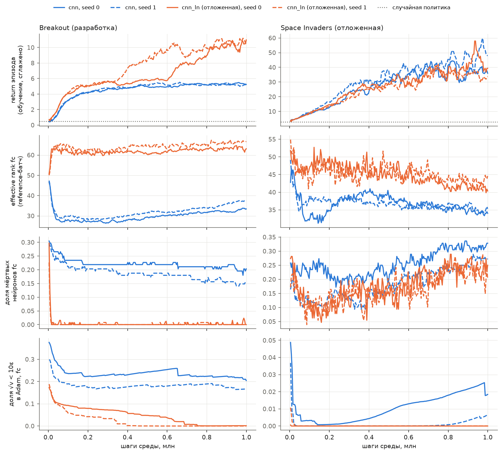

# Стенд PPO на MinAtar (спринт 02, T2–T3)

Код: `causal_trainability/ppo_minatar.py` (обучение), `causal_trainability/hybrids.py` (гибриды), `causal_trainability/pilot.py` (очередь пилота), `causal_trainability/telemetry.py`. Тесты — `tests/test_causal_ppo.py`. Тема — [карточка руководителя](../docs/topic_card.md). Код проверен независимым ревьюером; блокирующие замечания исправлены до запуска пилота.

## Устройство

- **PPO по образцу CleanRL.**
  - 8 сред MinAtar шагают синхронно, по 128 шагов на итерацию (1024 перехода).
  - 4 эпохи по 4 минибатча, clip 0.1, энтропия 0.01, value 0.5, обрезка градиента 0.5.
  - GAE: γ = 0.99, λ = 0.95. Advantage нормируется внутри минибатча.
- **Отличия от CleanRL — сознательные.**
  - Нет value clipping и нет снижения LR: постоянный шаг не смешивает потерю пластичности с расписанием.
  - Adam ε = 1e-8, как в DQN-пилоте.
  - Каналы наблюдения родные для игры: Breakout 4, Space Invaders 6, без дополнения до 10. С дополнением ~59% весов conv в Breakout никогда не получали бы градиент, и статистики Adam по conv искажались бы по-разному в разных играх.
- **Архитектуры.**
  - `cnn`: conv 16 (3×3) → fc 128 → головы actor и critic, ортогональная инициализация.
  - `cnn_ln`: то же, с LayerNorm перед каждой нелинейностью.
- **Обрезка эпизода на 10 000 шагов** не считается терминалом: награда последнего шага дополняется γ·V(наблюдение до reset). Сырые награды и наблюдения обрезанных эпизодов сохраняются, чтобы гибрид мог пересчитать бутстрап своим critic.
- **Разработка и отложенные (по плану).** Разработка — Breakout и `cnn`. Отложены Space Invaders и `cnn_ln`: на них в спринте 02 проверяется только, что базовый агент учится. Freeway и Seaquest не используются.

## Телеметрия (всегда, фоном)

- Пишется каждые 4 итерации. По слоям `conv`, `fc`, `actor`, `critic`:
  - ‖θ‖, ‖θ − θ₀‖, норма градиента, эффективный шаг ‖Δθ‖/‖θ‖ за окно;
  - Adam: ‖m‖, квантили √v, доля √v < 10ε, step.
- Мёртвые нейроны conv и fc и effective rank fc считаются на фиксированном reference-батче. Это 256 наблюдений случайной политики, одни и те же для всех прогонов одной игры.
- Метрики PPO: энтропия, approx KL, clip fraction, value и policy loss, explained variance; норма градиента до обрезки; масштаб логитов и V; std сырого advantage; return эпизодов; шагов/с.
- Проверено тестом: обучение с телеметрией и без неё совпадает побитово. Накладные расходы при записи каждой итерации ревьюер оценил примерно в 10%; при шаге 4 ожидается ≈ 2.5%. В пилоте это нужно перемерить на свободной машине.

## Снимки и чекпоинты

- **Снимки (L3):** веса и Adam на 0, 25, 50, 75 и 100% бюджета.
- **Чекпоинты для гибридов: возраст 0.00, 0.25 и 1.00.** Каждый делается после rollout и до обновления, поэтому веса, Adam, данные и critic относятся к одному моменту.
  - Содержимое: веса, θ₀, Adam, среды (pickle), генератор, текущие наблюдения, rollout.
  - sha256 записывается в `checkpoints.jsonl`.
  - Чекпоинт, записанный подпроцессом, загружается в другом процессе (тест).
- **Гибрид H(params, adam, data, targets)** собирается из чекпоинтов 0.00 и старого. Проверяется, что оба из одной истории. Advantage пересчитывается GAE выбранным critic на выбранных данных.
  - Гибрид «всё старое» воспроизводит веса и Adam побитово, а advantage — с точностью до последних битов (forward батчами разного размера).

## Известные ограничения и что перенесено

- **Лабораторный PPO-loss для T4.** Старые веса на свежих данных дают далёкое от 1 отношение к logprob поведения (у ревьюера 32% выход за clip). Поэтому в T4 ratio привязывается к политике самого гибрида, а чужое поведение поправляется усечённым весом важности, как в T1. Value-регрессия считается отдельно.
- **Свежие данные — один rollout θ₀** (почти равномерная политика, наград около 4%). Для T4 нужны три батча; их можно добрать из чекпоинта 0.00: среды и генератор в нём сохранены.
- **Продолжения обучения из чекпоинта (`PPO.load`) пока нет** — следующий спринт, живые ветки. Ревьюер проверил, что состояния для этого хватает: продолжение из 0.25 побитово совпадает с непрерывным прогоном.
- **«Смены условий» для адаптации пока нет** — вопрос к руководителю (раздел «Решения» плана).
- **Пилот: 2 сида на ячейку**, интервалы не показываются.
- `grad_norm` в телеметрии слоя берётся после обрезки на последнем минибатче. Средняя норма до обрезки пишется отдельно в метриках PPO.

## Результаты пилота

Запуск 22.10, после остановки DQN-кампании: `causal_trainability.pilot`, 8 прогонов по 1M шагов по очереди, один поток. Данные — `runs/causal-trainability/ppo_pilot/` (117 МБ, не в git). Сводка — [summary.json](../research/results/ppo-pilot/summary.json), график — [learning_curves.png](../research/results/ppo-pilot/learning_curves.png), скрипт `scripts/plot_ppo_pilot.py`.

### Агент учится

Return по 30 эпизодам с фиксированными seeds после 1M шагов; случайная политика — на тех же seeds.

| Игра | `cnn` s0 / s1 | `cnn_ln` s0 / s1 | случайная |
|---|---|---|---|
| Breakout (разработка) | 5.50 / 5.17 | 11.43 / 10.60 | 0.50 |
| Space Invaders (отложенная) | 33.2 / 52.8 | 62.3 / 43.9 | 2.93 |

Все 8 прогонов заметно лучше случайной политики, так что критерий T2 выполнен. В Breakout `cnn` выходит на плато около 5 примерно к 0.4M шагов, `cnn_ln` к 1M доходит до ≈ 11. На отложенных игре и архитектуре проверяется только то, что агент учится. Исходы ремонтов на них не смотрятся.

По телеметрии видно (разведочно, 2 сида), что `cnn` в Breakout рано теряет часть `fc`. Effective rank падает с ≈ 47 до ≈ 28 за первые 0.1M шагов. 16–20% нейронов `fc` мёртвые на reference-батче к концу; у 17–20% параметров `fc` √v < 10ε. У `cnn_ln` в Breakout мёртвых нейронов `fc` почти нет, а rank ≈ 63–67. Связь с плато не проверялась.

### Скорость и объём

- Один прогон на 1M шагов с полной телеметрией: 204–275 с, то есть 3640–4890 шагов/с в один поток. Space Invaders и `cnn_ln` медленнее.
- В одном потоке это ≈ 15 обучений по 1M в час, ≈ 2500 в неделю непрерывного счёта. Как скорость масштабируется на несколько параллельных процессов, не мерили. По памяти машины (14 ГБ) параллельных процессов будет несколько, а не 12.
- Диск: ≈ 15 МБ на прогон, в основном чекпоинты для гибридов (среды и rollout) и L3-снимки.

### Накладные расходы телеметрии

Замер на свободной машине: 3 пары прогонов по 200k шагов, «с телеметрией» и «без», порядок чередуется. Файл — [telemetry_overhead.json](../research/results/ppo-pilot/telemetry_overhead.json), скрипт `scripts/bench_telemetry_overhead.py`.
- Накладные расходы по парам: 8.4%, 4.6% и 4.3%; медиана **4.6%**, то есть в пределах 5% из `docs/observability_spec.md`.
- Первая пара шла первой в процессе, и прогрев от неё не отделён. Три пары — мало; если понадобится точная оценка, нужен замер с прогревом.

### Воспроизводимость

- У каждого прогона в индексе записаны revision (HEAD, sha256 файлов пакета, версии), config_hash и sha256 чекпоинтов.
- У 3 из 8 прогонов (Breakout `cnn` s1 и оба `cnn_ln`) в revision стоит флаг `dirty_causal_trainability`. Причина — незакоммиченный тогда `causal_trainability/lab.py` (T4), который обучение не импортирует. sha256 всех файлов обучения (`ppo_minatar.py`, `telemetry.py`, `pilot.py`, `__init__.py`) у всех 8 прогонов совпадают с закоммиченными.

## T3: гибриды на чекпоинтах пилота

Тесты `tests/test_causal_ppo.py` проходят: гибрид «всё старое» побитово воспроизводит чекпоинт, Adam привязан к параметрам гибрида, гибрид обучается. На настоящих чекпоинтах пилота (Breakout `cnn` s0 и s1, Space Invaders `cnn_ln` s0; возраст 0.25 и 1.00) гибрид «всё старое» побитово воспроизводит веса и все состояния Adam (m, v, step). Каждое состояние Adam привязано к параметру гибрида. Advantage, пересчитанные GAE, совпадают с сохранёнными побитово: максимальная разница 0. Обучение гибридов без ошибок проверено также 48 замерами T4 — [ppo_lab.md](ppo_lab.md).
