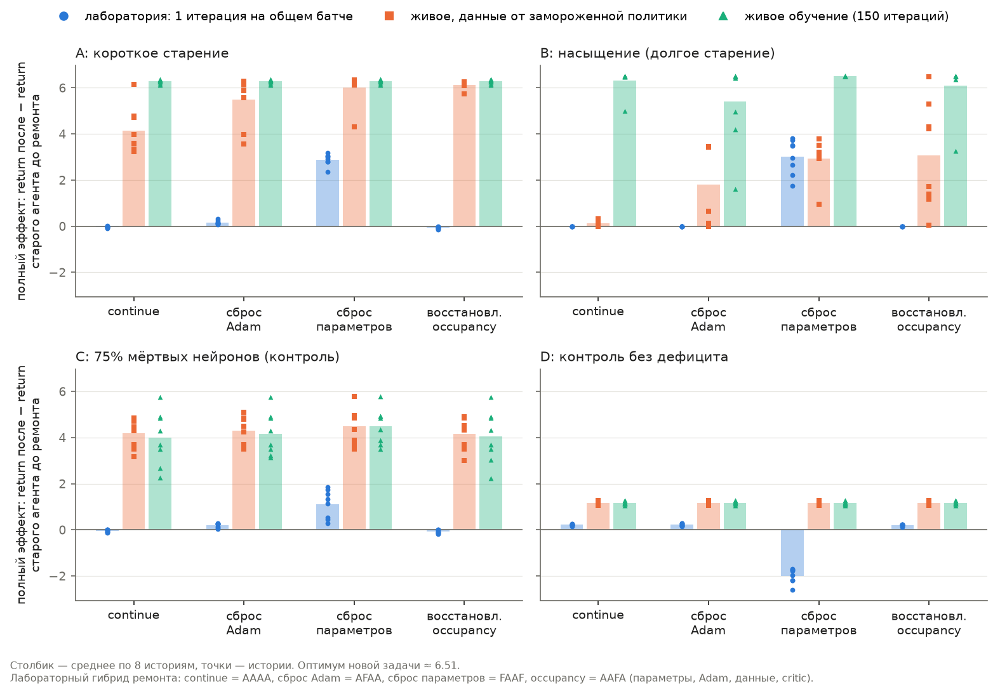

# Контрпример на MDP из двух состояний (спринт 02, T1)

Код — `causal_trainability/two_state.py`, тесты — `tests/test_causal_two_state.py`. Тема — [карточка руководителя](../docs/topic_card.md). Дизайн дважды проверен независимым ревьюером: первые версии давали предрешённый вывод.

## Предрегистрация (фиксируется до полного прогона, 2026-10-22)

**Вопрос.** Может ли лабораторный замер на общем батче и живой эффект ремонта разойтись из-за того, что on-policy агент сам меняет свои данные?

**Среда.** Два состояния s₁, s₂; действия «остаться» и «перейти». Горизонт 10, γ = 0.9, старт в s₁. В старой задаче награда за попадание в s₁, в новой — в s₂. Оптимум новой задачи ≈ 6.51.

**Обучаемый агент** — один и тот же везде.
- Сеть: тело 2→16 (ReLU), головы actor и critic.
- PPO: 4 эпохи на батч из 8 эпизодов, clip 0.2, Adam (lr 0.01, ε = 1e-8).
- Ratio привязан к политике самого агента в начале итерации.
- Данные чужой behaviour-политики поправляются усечённым весом важности (≤ 1).

**Старые агенты.** Сценарии фиксированы:

| Сценарий | Как получен |
|---|---|
| A, короткое старение | старение на старой задаче, пока π(перейти \| s₁) не станет ≤ 0.02 |
| B, насыщение | A + ещё 3000 итераций на старой задаче, естественное насыщение |
| C, мёртвые нейроны | у A убиты 75% живых скрытых нейронов; **сконструирован**, это контроль |
| D, контроль | обучен на новой задаче до 80% оптимума; дефицита нет, сброс не должен выигрывать |

Для каждого старения записывается, сошлось ли оно, то есть не упёрлось ли в лимит итераций.

**Меню** — 4 действия карточки. Каждое заменяет часть старого агента:

| Ремонт | Лабораторный гибрид (параметры, Adam, данные, critic-baseline) |
|---|---|
| `continue` | AAAA |
| `optimizer_reset` | AFAA |
| `parameter_reset` | FAAF: сбрасывается вся сеть, включая critic; Adam сохраняется |
| `occupancy_restoration` | AAFA |

- **`occupancy_restoration` вживую:** первые 25% итераций данные собирает свежая политика θ₀, с весом важности.
- **`parameter_reset` вживую:** агент после сброса сразу сам собирает данные политикой θ₀. Поэтому вживую расхождение с FAAF для этого ремонта отчасти задано определением. Вторичный гибрид FAFF (свежие данные) выводится отдельно.
- **`joint_reset`** (FFAF) — справочно, вне меню.
- **«Targets»** здесь — только critic, который служит baseline для advantage: MC-returns от critic не зависят.

**Основной исход — одинаковый с обеих сторон.** Полный эффект = return на новой задаче после обучения минус return старого агента до ремонта.
- Лаборатория: среднее по 16 общим батчам после одной итерации PPO гибрида.
- Вживую: после 150 итераций.
- Return считается точно, без шума оценки.

**Живой контроль `frozen_behaviour`.** Те же ремонты и тот же бюджет, но данные собирает фиксированная behaviour-политика — та, что служит источником данных в лаборатории, — поэтому обратной связи «агент → данные» нет. Для `occupancy_restoration` повторяется живая структура: первые 25% итераций данные от θ₀, дальше от замороженного агента после ремонта.

**Правила.** Пороги заданы до запуска; все правила выбирают из меню; regret считается по меню.

| Правило | Как выбирает | Порог |
|---|---|---|
| `crossed_lab` | argmax лабораторного полного эффекта по меню; если выигрыш над `continue` ниже порога — `continue` | 0.33 (5% оптимума) |
| `instant_only` | то же, но только по мгновенному скачку return, без обучения | 0.33 |
| `common_batch_params_only` | `parameter_reset`, если на свежих данных обучение FFFF − AFFF выше порога | 0.1 за одну итерацию |
| `readiness_own_data` | `parameter_reset`, если обучение FFFF − AAAA выше порога | 0.1 |
| `adam_state` | `optimizer_reset`, если доля √v < 10ε выше порога | 0.5 |

`instant_only` нужен, чтобы понять, есть ли у `crossed_lab` что-то сверх мгновенного скачка. В `adam_state` доля считается только среди параметров actor, которые хоть раз получали градиент (v > 0), — иначе правило мерило бы мёртвые нейроны.

**Сопоставление (STOP (а)).** Старые веса подгоняются двумя способами: по норме каждого слоя и по разрыву логитов в s₁ (энтропии). Остаток — это обучение FFFF минус обучение подогнанного гибрида при свежих Adam, данных и critic.

**Критерий расхождения.**
- Лучший ремонт определяется отдельно для каждой истории. Если второй ремонт отстаёт меньше чем на 0.1, это ничья.
- Расхождение через обратную связь — история, где лаборатория и `frozen_behaviour` выбирают один ремонт, а живое обучение — другой (без ничьих).
- Контрпример считается показанным в сценарии, если таких историй **не меньше 4 из 8**.
- Отдельно считаются истории, где лаборатория расходится и с живым обучением, и с `frozen_behaviour`. Это говорит о другой причине, например о горизонте: 1 итерация против 150.

**Объём и единица.** 8 историй (θ₀), по 4 живых сида. История — единица независимости.

**Телеметрия.** Собирается во всех прогонах: старение, лабораторные итерации, живые ветки. Один файл, `TelemetryStore`. Снимки: θ₀ и конец каждого старения, конец каждой живой ветки.

**Возможные вырожденные исходы (записаны до прогона).** Если доля √v < 10ε у старых агентов окажется около нуля, правило `adam_state` совпадёт с постоянным `continue`; порог после прогона не меняем. Если `crossed_lab` совпадёт с `instant_only`, честный вывод — сверх мгновенного скачка лаборатория ничего не добавляет.

**Ограничения, известные заранее.** Это иллюстрация на 8 историях, а не валидация. B и C частично сконструированы. Return считается точно — это оракул, которого в настоящем RL нет.

## Результаты (полный прогон 2026-10-22)

**Прогон.** Коммит `b7b62d8`, дерево кода чистое. 8 историй, 2045 с. Сводка — [summary.json](../research/results/two-state-counterexample/summary.json). Сырые данные и телеметрия лежат в `runs/causal-trainability/two_state_full_20261022/` (вне git). График построен скриптом `scripts/plot_two_state.py`.

### Предрегистрированный критерий: контрпример не показан

В каждом сценарии **0 из 8** историй дали «лаборатория = frozen ≠ живое». Планка — 4 из 8. Из 32 пар «сценарий × история» **30 оказались ничьими** во «живом» обучении: за 150 итераций почти любой ремонт доходит до одного и того же return.

| Сценарий | Полный эффект вживую, среднее по историям (continue / сброс Adam / сброс параметров / occupancy) | Лучший вживую |
|---|---|---|
| A, короткое старение | 6.28 / 6.28 / 6.28 / 6.28 | ничья 8/8 |
| B, насыщение | 6.31 / 5.40 / 6.51 / 6.08 | ничья 8/8 |
| C, мёртвые нейроны | 3.99 / 4.17 / 4.49 / 4.04 | ничья 6/8, сброс параметров 2/8 |
| D, контроль | 1.18 / 1.18 / 1.17 / 1.18 | ничья 8/8 |

Итог по предрегистрации: **расхождение через обратную связь в этом дизайне не показано**. Вероятная причина (это интерпретация) — длинный живой бюджет. В A и D итоги всех четырёх ремонтов совпадают в пределах 0.1. В B и C в каждой истории два лучших ремонта доходят до одного итога, хотя остальные отстают: в B сброс Adam в среднем 5.40 против 6.51. Даже в D сброс параметров вживую полностью отыгрывает мгновенную потерю −1.99 из лаборатории. Эту интерпретацию поддерживает площадь под кривой: по ней ремонты различаются сильнее, чем по итогу.

### Правила (предрегистрированные)

| Правило | Совпало с лучшим вживую (из 8: A / B / C / D) | Средний regret вживую (A / B / C / D) |
|---|---|---|
| `crossed_lab` | 6 / 7 / 8 / 1 | 0.00 / 0.00 / 0.00 / 0.00 |
| `instant_only` | 6 / 7 / 8 / 1 | 0.00 / 0.00 / 0.00 / 0.00 |
| `common_batch_params_only` | 2 / 5 / 2 / 0 | 0.00 / 0.19 / 0.50 / 0.00 |
| `readiness_own_data` | 4 / 5 / 6 / 1 | 0.00 / 0.19 / 0.28 / 0.00 |
| `adam_state` | 0 / 0 / 0 / 1 | 0.01 / 0.20 / 0.50 / 0.00 |

- **`crossed_lab` и `instant_only` выбрали одно и то же во всех 32 случаях.** Сверх мгновенного скачка return лаборатория ничего не добавила; этот исход был записан заранее как возможный.
- **`adam_state` вырожден.** Доля √v < 10ε среди обновлявшихся параметров равна 0 у всех старых агентов, кроме одной истории B (0.12). Поэтому правило всегда выбирает `continue`, как и было оговорено заранее.
- **Совпадения считались по argmax без ничьих.** Если живые ремонты отличаются меньше чем на 0.1, «совпадение» мало что значит. Regret при этом почти нулевой у всех правил.

### Сопоставление (STOP (а))

- **B, насыщение.** Предрегистрированный дефицит обучения весов на свежих данных до подгонки — 0.13 [0.04; 0.23] (min–max по историям). Остаток после подгонки по норме — −0.07 [−0.20; 0.08]. Но у контроля D такой «дефицит» ещё больше: 0.18 [0.06; 0.35]. Метрика за одну итерацию не отличает насыщение от контроля, поэтому **STOP (а) для B — неопределённо**.
  - Разведочно (величина MnAAA − AAAA не предрегистрирована): у старого агента в B обучение за итерацию нулевое, а подгонка по норме при прочих старых частях даёт +1.93 [1.58; 2.51].
- **A.** Остаток после подгонки −0.11 [−0.24; 0.09]: дефицита обучаемости весов нет.
- **C.** Остаток +0.09 [−0.02; 0.20]: мал. Лабораторный дефицит параметров на свежих данных +0.00 [−0.19; 0.13]: за одну итерацию убитые нейроны почти не мешают учиться. В лаборатории выигрыш сброса в C — мгновенный скачок return (свежая политика ≈ 3.2 против ≈ 2.0 у C).
  - Вживую разрыв держится до конца: итог 6.51 против 6.00 у continue, площадь под кривой 6.12 против 5.05. В frozen-контроле картина та же.
  - Значит, дефицит C есть, но одна лабораторная итерация его не видит. Причина — горизонт, а не обратная связь через данные.

### Разведочные наблюдения (не предрегистрированы)

- **B: живое и «замороженное» обучение расходятся по величине и по порядку ремонтов.**

  | | continue | сброс Adam | сброс параметров | occupancy |
  |---|---|---|---|---|
  | Лаборатория | 0.00 | 0.00 | +3.02 | 0.00 |
  | Frozen | +0.14 | +1.82 | +2.93 | +3.08 |
  | Живое | +6.31 | +5.40 | +6.51 | +6.08 |

  - Площадь под кривой вживую: continue 5.35, сброс Adam 3.98. Медиана итераций до 90% оптимума — сначала медиана по сидам внутри истории, затем по историям: 32.5 и 80.
  - Разница «сброс Adam − continue» по историям. Вживую сброс Adam хуже в 3 историях из 8 (−4.85, −1.54, −2.32), лучше в одной (+1.50), в остальных разницы нет; медиана −0.04. В frozen-контроле сброс Adam помогает в 5 историях из 8, а по площади под кривой даёт 1.64 против 0.13 у continue. В двух из трёх «вредных» историй он не помогает и в frozen. Вывод «сброс Adam вживую мешает» держится на 3 историях из 8 и неустойчив.
  - **Правдоподобный механизм (не проверен):** у старого critic V(s₁) осталась от старой задачи. На новой задаче return равен 0, advantage отрицателен, и это толкает политику прочь от «остаться». Политика начинает посещать s₂ и получает награду. В frozen-контроле данные всегда от старой политики: critic быстро обнуляется, и толчок пропадает. Механизм объясняет только разрыв continue между живым и frozen (6.31 против 0.14), но не порядок ремонтов. Он специфичен для игрушки, где награды старой и новой задачи противоположны.
  - Это расхождение через обратную связь по *величине* эффектов. Выбор лаборатории в B вживую перенёсся: regret 0.00, совпадение 7 из 8. В предрегистрированный критерий это расхождение не попадает.
- **A: та же картина, слабее.** continue: frozen +4.14, вживую +6.28.
- **D: сброс параметров стоит времени, но не итога.** Площадь под кривой вживую — 6.18 против 6.41 у continue, итог одинаковый.

### Что из этого следует

1. **Как контрпример дизайн не сработал.** Задача слишком лёгкая, а живой бюджет слишком длинный: итоги ремонтов сходятся. Для следующей версии итог стоит мерить на коротком бюджете, или основным исходом брать площадь под кривой. Это меняет предрегистрацию и потому требует нового прогона с новой записью, а не пересчёта этого.
2. **В B величины эффектов вживую сильно отличаются от лаборатории и frozen-контроля** (continue: 0.00 / 0.14 / 6.31), а выбор лучшего ремонта перенёсся (7 из 8). Риск из карточки «выигрыш на общем батче не переносится на живого learner» здесь проявился для величин, а не для решения. Наблюдение разведочное.
3. **Лабораторный выбор (`crossed_lab`) здесь равен выбору по мгновенному скачку return.** Сверх `instant_only` лаборатория не дала ничего.
4. **STOP (а) — неопределённо.** Метрика обучения за одну итерацию не отличила насыщение B от контроля D. В A дефицита обучаемости весов нет. В C дефицит есть, но одна итерация его не видит.

**Ограничения.** Это игрушка с оракульным return; 8 историй; B и C частично сконструированы; живой бюджет один. Текст результатов проверен независимым ревьюером, его поправки внесены.
