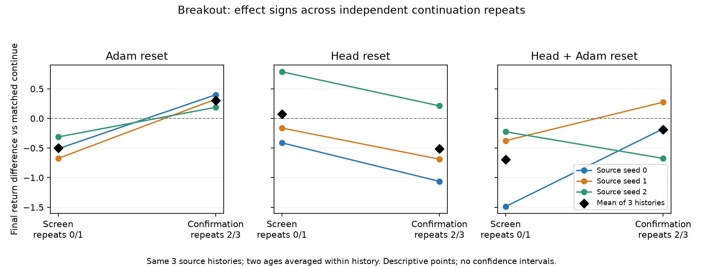

# 11 октября: continuation confirmation и восстановление очереди

## Что проверено и зачем

Повторно проверены 144 завершённых online ветки: первый screen 96/96 и confirmation Breakout 48/48. Confirmation Asterix ещё выполняется. Полных matched checkpoint×repeat панелей 36; исходных histories по-прежнему шесть, по три на игру. Повторы 2/3 дают новые continuation/evaluation streams, но не новые source histories.

Проверка нужна, чтобы отделить воспроизводимый response ремонта от случайного ранжирования первых двух продолжений. Новые данные не смешиваются с первым screen при оценке воспроизводимости его вывода.

Источник — `runs/minatar-repair-20261007/outcomes.jsonl`, SHA256 `594efebfc577c50b9a73b348b34fbd9c6275f219c97019c9ec6781da0c8e9402`. Компактный неизменяемый срез — [20261011T0954Z_confirmation.json](20261011T0954Z_confirmation.json); воспроизведение — `scripts/audit_continuation_confirmation.py`. В learner не внесено изменений; аудит выполняет ноль optimizer updates. Независимый read-only аудит `/root/confirm_audit_oct11` воспроизвёл SHA, effects и repeat-split contrasts.

## Результат: знак optimizer effect не воспроизвёлся

Primary outcome — final raw return после 50k transitions/optimizer updates. Effect — парная разность с continue. Сначала одинаково усредняются два возраста и два repeats внутри trajectory_id, затем три histories.

- **Adam reset:** первый screen −0.500000; confirmation +0.304167. По source seeds 0/1/2: −0.5125/−0.6750/−0.3125 → +0.4000/+0.3250/+0.1875. Все три знака сменились.
- **Head reset:** +0.070833 → −0.512500. По histories: −0.4125/−0.1625/+0.7875 → −1.0625/−0.6875/+0.2125.
- **Head + Adam reset:** −0.695833 → −0.191667. По histories: −1.4875/−0.3750/−0.2250 → −0.1750/+0.2750/−0.6750.
- **Head×optimizer interaction**, `joint − head − optimizer + continue`: −0.266667 → +0.016667. По histories: −0.5625/+0.4625/−0.7000 → +0.4875/+0.6375/−1.0750.

Вывод о стабильном вреде Adam reset в Breakout снимается. Новый положительный знак не доказывает стабильную пользу: он получен на тех же трёх histories, а предыдущие независимые продолжения дали противоположный результат. При объединении четырёх repeats средний optimizer effect равен −0.097917, но это не устраняет наблюдаемую нестабильность. Интервалы и p-values при n=3 не вычисляются.

**Классификация: неопределённо.** Различие между играми из первого screen больше нельзя представлять как воспроизводимый optimizer contrast. Исходный положительный Asterix effect +0.3375 остаётся screening finding до окончания его confirmation.

## Повторная проверка выбора победителя

В exploratory cross-fitting для каждого checkpoint выбирается действие с максимальным средним final return на двух training repeats; оно оценивается на двух других repeats. SBS выбирается по всем шести Breakout checkpoints training половины. При равенстве используется порядок меню `continue → optimizer → head → joint`.

- Screen → confirmation: выбранный по trials repair +0.029167 относительно continue и +0.541667 относительно SBS, которым оказался head reset.
- Confirmation → screen: −0.533333 относительно continue и −0.033333 относительно SBS, которым оказался optimizer reset.
- Среднее двух направлений: **−0.252083 относительно continue**, +0.254167 относительно training SBS.
- Дополнительно SBS выбирался на training repeats двух других histories: среднее двух направлений +0.289583; эта положительная разность также соседствует с отрицательным результатом относительно continue.

Положительная разность с SBS возникает при неустойчивом выборе самого SBS; она не доказывает пользу диагностики. Этот chooser использует уже полученные repair outcomes на тех же source histories, не является pre-repair predictor, не проходит перенос на unseen history и не учитывает стоимость пробного обучения. Это проверка устойчивости labels, а не deployable selection result.

## Проверки корректности

У 144 веток нет failure_reason, нечисловых finals или повторных job_id. Все завершили по 50k transitions/updates, без probe updates. Внутри каждой панели совпали checkpoint SHA, continuation seeds и evaluation seeds во всех четырёх точках; каждый mean_return реконструирован из 20 episode returns. Для каждого Breakout checkpoint continuation seeds различны между четырьмя repeats; final evaluation streams двух половин не пересекаются. Ошибку инфраструктуры или смешение бюджета в завершённой confirmation не обнаружили.

## Операционная остановка и восстановление

На проверке 11 октября прежние supervisor/coordinator и обе worker leases были мертвы; последние root progress и savepoints — с 9 октября, около 17:24 UTC. В журнале обучения нового traceback нет. Windows фиксирует выключение 10 октября и последующий boot 10 октября 23:24 MSK. Перезагрузка прекращает процессы, но данных недостаточно, чтобы объяснить точное время последнего прекращения progress; не объявляем это MemoryError или numerical failure.

Перед возобновлением проверены canonical config hash, SHA всех девяти scientific modules, отсутствие живых leases и обе пары branch savepoint на 40k/50k. SHA сохранений совпали: `8fc34c98edb8089346cc23683d1f2e58ba79217b07fc674d273c90b3822e9415` и `c6a555416ff8416f9101084a632171af1a61358088729d5b1d5a708f02fc3b1a`. Preflight — [20261011T0949Z_restart.json](20261011T0949Z_restart.json).

Запущен один hidden supervisor с двумя workers и прежней очередью/seeds. Старый календарный пакет закрыт самим frozen runner: 7,561,975 accounted updates и 219,662.94 s (61.02 h), включая длительный простой. Metadata не переписывались. Пакет 2 начат перед следующей wave; потолок 12M updates сохраняется, строгий wall deadline между запусками текущий код не обеспечивает. Это инфраструктурное ограничение, отдельно от научных результатов.

В проверке после возобновления оба optimizer продолжения завершились, workers перешли к head reset и дошли до 17,203/17,206 шагов. Coordinator/supervisor живы, child progress свежий, worker_error отсутствует; в root 146 строк, две новые Asterix строки ещё не образуют полного меню. Это не меняет научный срез 144 строки выше. [Снимок живого состояния](20261011T0957Z_resumed.json) фиксирует точное время, PID и clocks. В текущем `REPORT.md` удалены восемь показанных intervals при n=3 отдельным редакционным postprocessing; estimates/raw данные и frozen analysis code не изменены.

## Следующий тест

Продолжить существующую confirmation Asterix. До полного среза не выбирать лучший repair по разному числу repeats между играми. Перед adaptive проверить отсутствие incomplete/failed histories. Не запускать новые методические серии до разрешённой границы спринта; следующий campaign output_root должен закрыть whitelist/calibration, deadline, stress-selection propagation и длинный timestep precision control из `docs/research_program_completion_audit.md`. Reserved Seaquest/Freeway остаются закрытыми до корректного protocol freeze и подтверждения development signal; сам exploratory gate текущего runner для такого открытия недостаточен.
