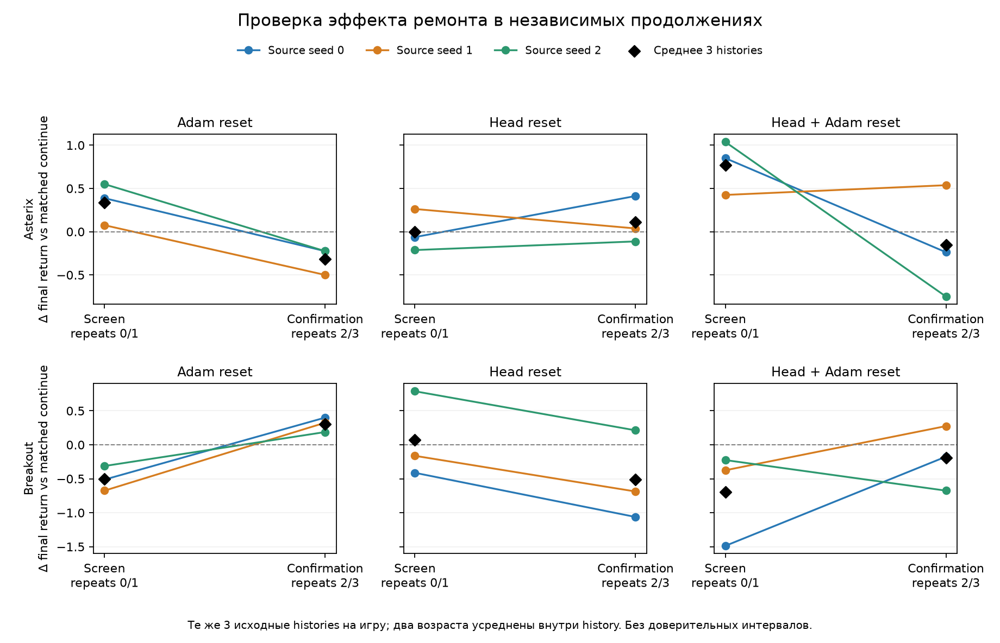

# Полное continuation confirmation: 192 ветки

## Что проверено → зачем

Завершены исходный screen 96/96 и confirmation 96/96: Breakout/Asterix, source seeds 0–2, два возраста, четыре repairs, repeats 0–3, по 50k transitions/optimizer updates. Независимая единица остаётся source trajectory: три histories на игру. Новые continuation/evaluation streams не увеличивают число source histories.

Сопоставление repeats 0/1 с 2/3 проверяет воспроизводимость первоначальных effects и labels для выбора ремонта. Источник — 192 строки `runs/minatar-repair-20261007/outcomes.jsonl`, SHA256 `a895b8b6ae778f3878ada2e8297b9945d0c4cad3931a885e4d2813ad6115cf16`. Компактный срез — [full_confirmation.json](20261011T1244Z_full_confirmation.json); code SHA read-only аудита записан внутри. Числа Asterix и matched-stream checks независимо воспроизведены `/root/confirm_audit_oct11`.

Все 48 checkpoint×repeat панелей полные. Нет numerical failures, нечисловых finals или дубликатов. Проверены бюджеты 50k/50k, общий checkpoint SHA и continuation/evaluation seeds внутри меню, reconstruction means по 20 episodes во всех точках. Для каждого pilot checkpoint четыре continuation seeds различны, final evaluation streams двух половин не пересекаются. Repair seeds могут различаться между действиями; их равенство не заявляется. Infrastructure errors не смешаны с отрицательными repair outcomes.

## Результат: screening benefits не воспроизвелись

Primary estimand — paired final raw-return difference относительно continue, с равным весом возрастов/repeats внутри history, затем histories.

**Asterix, screen → confirmation:**

- Adam reset: **+0.337500 → −0.316667**; по histories +0.3875/+0.0750/+0.5500 → −0.2250/−0.5000/−0.2250. Все три знака сменились.
- Head reset: −0.004167 → +0.112500; по histories −0.0625/+0.2625/−0.2125 → +0.4125/+0.0375/−0.1125.
- Head + Adam reset: **+0.770833 → −0.150000**; по histories +0.8500/+0.4250/+1.0375 → −0.2375/+0.5375/−0.7500. Положительный знак сохранил только seed 1.
- Interaction `joint − head − optimizer + continue`: +0.437500 → +0.054167; по histories +0.5250/+0.0875/+0.7000 → −0.4250/+1.0000/−0.4125.

**Breakout, screen → confirmation:** Adam −0.500000 → +0.304167; head +0.070833 → −0.512500; joint −0.695833 → −0.191667; interaction −0.266667 → +0.016667. Все три optimizer знака также сменились, в противоположном Asterix направлении. Подробные histories — в [предыдущем audit](20261011T0954Z.md).

При объединении четырёх repeats mean effects Adam/head/joint: Asterix +0.010417/+0.054167/+0.310417; Breakout −0.097917/−0.220833/−0.443750. Положительный pooled joint у всех трёх Asterix histories не является independent replication: две histories дали отрицательный joint effect в confirmation. Объединение скрывает различие половин, поэтому screening finding не объявляется подтверждённым по pooled среднему.

**Классификация: неопределённо.** Устойчивой пользы optimizer/joint reset и полезного индивидуального выбора здесь не установлено. Это не доказывает отсутствие любых repair effects или четырёх причин деградации. При n=3/game intervals и significance не вычисляются; точный источник нестабильности пока не установлен.

## Выбор победителя → ограничения

Exploratory checkpoint chooser выбирает максимальный mean final return по двум training repeats и оценивается на другой половине. SBS выбирается только по training половине всех шести checkpoints соответствующей игры; дополнительный SBS исключает текущую trajectory целиком. Ничьи разрешаются по порядку меню `continue → optimizer → head → joint`.

Для Asterix screen→confirm chooser: −0.108333 vs continue, +0.041667 vs training SBS (joint). Обратное направление: +0.066667 vs continue, +0.070833 vs training SBS (head). Среднее двух направлений: **−0.020833 vs continue**, +0.056250 vs SBS; с leave-history-out SBS +0.045833. Для Breakout среднее: **−0.252083 vs continue**, +0.254167 vs SBS (+0.289583 vs leave-history-out SBS).

В Asterix seed 2, age 50k имеется точная training ничья continue=optimizer=1.025. Если выбрать optimizer вместо объявленного continue, forward chooser становится −0.187500 vs continue и −0.037500 vs SBS. Поэтому маленькое положительное превосходство над SBS чувствительно к одной ничьей. Правило не подбиралось по confirmation.

Это outcome-based label stability на тех же source histories, не pre-repair diagnostic predictor, не unseen-history transfer и не budget-adjusted short-probe chooser. Положительное превосходство над нестабильно выбранным SBS при отсутствии пользы vs continue не подтверждает selection signal. Reserved transfer остаётся закрытым.

## Harm и recovery → что сохранилось

Descriptive harm — отрицательный paired final в checkpoint×repeat панели, без предположения независимости панелей. Asterix screen: Adam/head/joint 2/12, 4/12, 3/12; confirmation: 8/12, 5/12, 7/12. По четырём repeats: 10/24, 9/24, 10/24; у head/joint дополнительно по одной нулевой панели. Breakout по четырём repeats: 14/24, 13/24, 16/24; у Adam одна нулевая панель.

Secondary normalized AUC относительно matched continue показывает стоимость потери функции. Breakout head AUC −0.675625 → −0.658750, joint −1.034583 → −0.804375. Их AUC effects отрицательны у всех трёх histories в каждой половине, хотя seed 2 head final effect положителен в обеих. Это воспроизведённый описательный recovery cost данного head intervention, не доказательство потери trainability во всей популяции.

Asterix head AUC +0.199792 → +0.150208; joint +0.581667 → +0.078750; Adam +0.260208 → +0.028542. Средние paired immediate drops head/joint: Asterix −0.850 → −0.700; Breakout −3.058333 → −3.283333. Adam immediate effect равен нулю, как ожидается при сохранённой функции. Primary final return после просмотра результатов не заменяется AUC. Данные по curves/AUC/histories — [recovery summary](20261011T1244Z_recovery_histories.json), воспроизведение — `scripts/summarize_confirmation_recovery.py`; независимое усреднение raw panels совпало с equal-history calculation.

## Решение → следующий тест

Сохранить исходный screen и independent confirmation отдельными когортами, снять исходные claims стабильного optimizer contrast между играми. Frozen runner получил exploratory `gate=uncertain` и heuristic `baseline_learned_fraction=1.0`; последнее не является статистическим доказательством достаточного обучения всех исходных агентов.

11 октября существующая очередь автоматически перешла к source seeds 3–5, затем continuation repeats 4–5 на seeds 0–5. Это заранее предусмотренное увеличение разрешения. Полная natural панель после расширения должна иметь шесть histories на игру, два возраста и шесть repeats: **576 branches**, на 384 больше текущего пилота. Source histories отвечают на вопрос о переносимости response между агентами; дополнительные repeats — о его воспроизводимости на одной history. Новые outcomes не включаются в retrospectively verified срез 192 строк.

После расширения проверить полные matched panels и отсутствие failures/incomplete, затем выполнить уже запланированный LR control. Если signal отсутствует, границы применения проверяются предусмотренными replay-ratio/reward-scale strata. Исправления методики/stress-selection/deadline/feature whitelist требуют нового output_root согласно AGENTS.md; текущие `experiments/` и `configs/` не менялись. Открытые обязательные пункты — `docs/research_program_completion_audit.md`; marker `initial_program` сам по себе не завершает всю программу.

## Возобновление 12 октября

После последней проверки процессов снова не было. Windows event 1074: выключение через StartMenuExperienceHost 11 октября 16:46 MSK; последнее root progress около 16:45 MSK. В журналах нет нового traceback/MemoryError/FPE. Перед hidden resume проверены исходные code/config hashes, отсутствие живых leases и source savepoints: Breakout seed 5 на 190k env/185001 updates, SHA `309dcdc922dd049e36382b787ca93783738173a2865444995e9fdc68fd821b1a`; завершённый Asterix seed 3 на 200499 env/195500 updates также имеет matched SHA. [Preflight](20261012T0949Z_restart.json).

Возобновлена та же очередь с двумя workers, без повторного coordinator и без смены seeds. На preflight календарный пакет достиг 24h из-за длительного простоя; frozen runner закрывает его перед новой wave. Metadata сохраняются, строгий календарный ceiling текущим кодом не гарантируется. Это отдельное ограничение инфраструктуры, не numerical/repair outcome. Итоговые PID, package и clocks проверяются в live manifest/progress.
